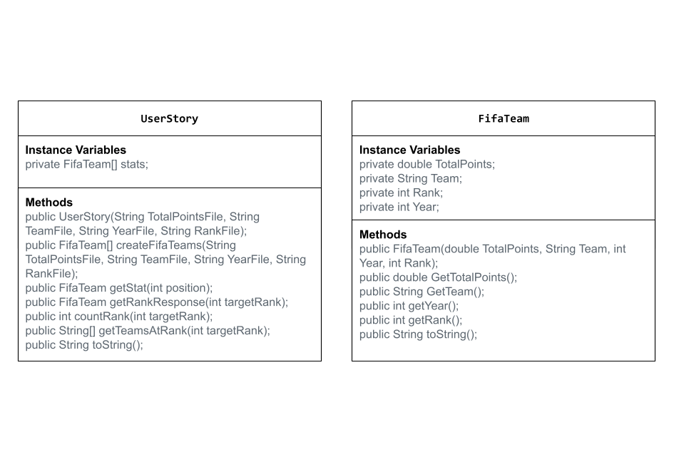

# Unit 2 - Data for Social Good Project

## Introduction

Software engineers develop programs to work with data and provide information to a user. Each user has different needs based on the information they are looking for from data. Your goal is to create a data analysis program for your user that stores and analyzes data to provide the information they need.

## Requirements

Use your knowledge of object-oriented programming, one-dimensional (1D) arrays, and algorithms to create your data analysis program:
- **Write a class** – Write a class to represent your user or business and store and analyze their data with no-argument and parameterized constructors.
- **Create at least two 1D arrays** – Create at least two 1D arrays to store the data that your user needs information about.
- **Write a method** – Write a method that finds or manipulates the elements in a 1D array to provide the information your user needs.
- **Implement a toString() method** – Write a toString() method that returns general information about the data (for example, number of values in the dataset).
- **Document your code** – Use comments to explain the purpose of the methods and code segments and note any preconditions and postconditions.

## User Story 

> As a soccer enthusiast, I want to figure out which FIFA team to root for, so that I can bet on the winning team.

## Dataset 

Dataset: [FIFA Men's World Ranking](https://www.kaggle.com/datasets/lucasyukioimafuko/fifa-mens-world-ranking?resource=download) 
- **Year** (int) - the year for the current standings 
- **Rank** (int) - the corresponding rankings of each team 
- **Team** (String) - the names of the team 
- **Total Points** (double) - the total number of points each team has 

## UML Diagram 

## Description 

The purpose of my project is to analyze data from the FIFA men's world rankings to help soccer fans decide which team to support based on past performance. To do this, I used a dataset containing team names, years, rankings, and total points; stored the data in text files; and used it to create four 1D arrays and an array of FifaTeam objects to organize each team's information. I used a UserStory class to create methods, loops, and conditional statements that helped me analyze the rankings through methods such as the countRank() method, which counted how many times a certain rank appears in the dataset, and the getTeamsAtRank() method, which created a new array containing the names and years of teams with a specified rank. In addition, I used constructors, instance variables, accessor methods, and toString() methods to organize and display the data, helping users identify high-performing FIFA teams and make informed decisions about which team to support.
